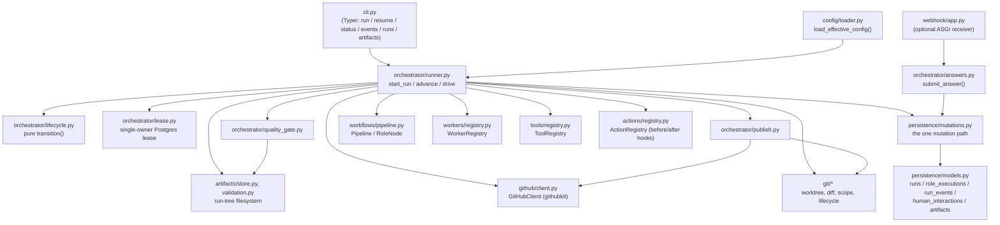

<!-- generated-by: gsd-doc-writer -->
# Architecture

## System overview

Dark Factory is a durable software-delivery orchestration platform for AI
engineering agents. It drives a single development task through an ordered
pipeline of engineering roles — `BA` → `ARCHITECTURE` → `DEVELOPMENT` → `QA`,
followed by an independent `VERIFYING` quality gate and `PUBLISHING` step —
where each role's actual engineering work is performed by an external AI
agent runtime (Claude Code, GitHub Copilot, Hermes, or `FakeWorker` for
tests). Dark Factory itself never writes code: it decides *what happens
next* in the delivery lifecycle, while the assigned worker decides *how* to
perform the engineering work inside its role.

The architecture is a **deterministic, resume-first state machine** backed
entirely by Neon PostgreSQL. Every lifecycle fact — run status, current
role, retry counters, worker results, audit events, pending questions — is a
column or row in Postgres, never an in-process variable. The single
orchestrator entry point, `advance(run_id)`, always starts by reconstructing
the run's entire state from the database and executes exactly one committed
step before returning. This is what makes "resume after a crash" and "run
the happy path" the same code path: there is no separate recovery branch to
drift out of sync, and any process on any machine — a local CLI invocation,
a GitHub Actions job, a webhook receiver — can call `advance` on a run id
and pick up exactly where a previous process stopped.

Secondary architectural concerns are each isolated behind their own module
boundary: a `git` package that owns worktrees, commits and write-scope
enforcement; a `github` package that is the only code constructing a
`githubkit` client; a pluggable `WorkerRegistry` / `ToolRegistry` /
`ActionRegistry` / `.dark-factory.yaml` config layer so new workers, tool
capabilities, hooks and pipelines can be added with zero orchestrator
changes; and a `webhook` receiver that is a separate optional extra, never
imported by the core.

## Component diagram



Dark Factory's own `pyproject.toml` enforces two of these boundaries
structurally rather than by convention: the `mcp` and `webhook` extras must
be uninstallable without breaking the orchestrator core, and tests
(`test_no_mcp_import_in_core.py`) walk the import graph to prove it.

## Data flow

A run's lifecycle, from creation to a terminal state, flows through the
same small set of steps on every call to `advance(run_id)`:

1. **Classify and create.** The CLI's `run <source>` command resolves
   `.dark-factory.yaml` + role YAMLs into an effective-config snapshot
   (`config/loader.py`), classifies the source string (`text:`, `spec:`, or
   `github:`-prefixed) via `input/resolver.py`, loads the normalized task
   via `input/loaders.py`, and calls `orchestrator.runner.start_run`, which
   inserts a `CREATED` row and persists the resolved snapshot verbatim onto
   `runs.workflow` — this snapshot is the *only* configuration source for
   every later resume; no in-flight run is affected by a later config edit.
2. **Reconstruct.** Every call to `advance(run_id)` opens a fresh session
   and calls `persistence.repositories.load_run_state`, which rebuilds the
   full `RunState` (status, current role/step, latest `role_executions` row,
   pending question/answer, persisted config snapshot) from Neon columns
   alone — nothing is carried between calls in process memory.
3. **Claim the lease.** `orchestrator/lease.py` claims a single-owner lease
   via one conditional `UPDATE ... RETURNING` against `runs.owner_token` /
   `runs.lock_expires_at`, guaranteeing no two processes mutate the same run
   concurrently. A background thread renews the lease on a heartbeat while
   the step runs.
4. **Execute exactly one committed step.** Depending on state, this is
   entering the first role (`CREATED` → first role), entering a later role
   (inserting its `role_executions` row), or running the current role's
   worker. Running a role: `git/worktree.py` ensures a per-run git worktree
   exists on the run's working branch, `context/builder.py` assembles the
   role's `RoleContext` from its declared `inputs`, before-hooks run through
   `ActionRegistry`, the assigned `CodingWorker` (from `WorkerRegistry`) is
   invoked via `execute()` or `resume()`, and after-hooks run.
5. **Map the result to a signal.** The worker's `WorkerResult.status`
   (`COMPLETED` / `FAILED` / `NEEDS_INPUT`) is mapped to a `Signal`
   (`domain/signal.py`) — never the worker's prose. On `COMPLETED`, declared
   machine artifacts are schema-validated, write-scope and artifact-scope
   are enforced against the role's diff, and the run tree is committed and
   pushed to the working branch.
6. **Transition and persist.** The pure `orchestrator.lifecycle.transition`
   function computes `(next_status, next_role, next_step)` from
   `(status, signal, pipeline)` alone — no I/O, no database access. The
   result is written through `persistence.mutations.apply_transition`, the
   single mutation path for every lifecycle column, inside one transaction
   that also writes the role-execution row, counters, and `run_events` audit
   row(s).
7. **Terminal-role gate and publish.** When the terminal role's own attempt
   completes with a PASS verdict, `orchestrator/quality_gate.py` re-runs the
   configured independent commands; a PASS there triggers
   `orchestrator/publish.py`, which idempotently commits, pushes, and opens
   (or adopts an existing) GitHub pull request via `GitHubClient`. A FAIL
   from either the QA verdict or the quality gate bounces the run back to
   `DEVELOPMENT` under a configured iteration cap, or fails the run once the
   cap is exhausted.
8. **Pause and resume.** A `NEEDS_INPUT` worker result moves the run to
   `WAITING_HUMAN` and releases the lease. A human answer — via
   `dark-factory resume --answer` or the webhook receiver's
   `orchestrator/answers.submit_answer` — is the only way out of
   `WAITING_HUMAN`; the webhook path also dispatches a GitHub Actions
   `workflow_dispatch` so a laptop-paused run can finish headlessly in CI.
9. **Drive to a stop.** The CLI's `drive` loop calls `advance` repeatedly
   until the run reaches a *stop* status (`COMPLETED`, `FAILED`, or
   `WAITING_HUMAN`) — distinct from the narrower *terminal* set
   (`COMPLETED`, `FAILED`) from which nothing resumes.

## Key abstractions

| Abstraction | File | Role |
|---|---|---|
| `advance(run_id)` / `drive(run_id)` | `orchestrator/runner.py` | The single, always-resume-first orchestrator entry point; executes exactly one committed step per call. |
| `transition(state, signal, pipeline)` | `orchestrator/lifecycle.py` | The pure function that computes the legal next `(status, role, step)` for a `(RunStatus, Signal)` pair — no I/O, fully unit-testable. |
| `RunStatus` / `Signal` | `domain/status.py`, `domain/signal.py` | Closed vocabularies: every lifecycle state a run can occupy, and every control signal the orchestrator reacts to (mapped only from `WorkerResult.status`, never from worker prose). |
| `Pipeline` / `RoleNode` | `workflows/pipeline.py` | An ordered, length-agnostic sequence of role→worker assignments, rebuilt on every resume from the run's persisted config snapshot — never from a live file. |
| `CodingWorker` | `workers/base.py` | The three-method contract (`execute`, `resume`, `capabilities`) every agent runtime adapter implements, so the orchestrator never branches on a worker's name. |
| `WorkerRegistry` / `ToolRegistry` / `ActionRegistry` | `workers/registry.py`, `tools/registry.py`, `actions/registry.py` | Three structurally identical name-to-callable allowlists for workers, tool capabilities, and before/after hooks — new entries plug in with zero orchestrator change. |
| `apply_transition` / `create_run` | `persistence/mutations.py` | The one lifecycle mutation path: every write to `runs`, `role_executions`, `run_events`, and `human_interactions` goes through here, inside one transaction, with redaction applied at the single call site. |
| `run_lease` / `claim_lease` | `orchestrator/lease.py` | The single-owner Postgres lease (`UPDATE ... RETURNING`) that serializes concurrent mutation without a second coordination system (no Redis, no advisory locks). |
| `load_effective_config` | `config/loader.py` | Resolves `.dark-factory.yaml` + role YAMLs into one JSON-serializable effective-config snapshot at run creation; never imported by the orchestrator core. |
| `GitHubClient` | `github/client.py` | The only module constructing a `githubkit` client; redacts every outbound error before raising. |
| `ensure_worktree` / `enforce_write_scope` / `enforce_artifact_scope` | `git/worktree.py`, `git/scope.py` | Per-run git worktree lifecycle and the authorization controls that revert a role's changes outside its declared `write_scope` or artifact boundary. |

## Directory structure rationale

```
src/dark_factory/
├── cli.py            # Typer CLI: run, resume, status, events, runs, artifacts
├── orchestrator/      # The deterministic outer lifecycle: runner, lifecycle,
│                       #   lease, answers, quality_gate, publish
├── workflows/          # Pipeline construction from the persisted config snapshot
├── domain/             # Closed vocabularies and pydantic boundary models
│                       #   (RunStatus, Signal, WorkerResult, artifacts, views)
├── persistence/        # SQLAlchemy 2.0 ORM models, repositories (reads),
│                       #   and the one mutation path (writes)
├── workers/            # The CodingWorker contract and its adapters:
│                       #   claude_code, copilot, hermes, fake
├── tools/              # ToolRegistry — the deny-by-default capability gate
├── actions/            # ActionRegistry — before/after role hooks
├── roles/              # Built-in role definitions (e.g. the BA role)
├── config/             # .dark-factory.yaml / role-YAML loading and validation
├── git/                # Worktree, diff/commit/push, write-scope and
│                       #   artifact-scope enforcement — all subprocess-based
├── github/             # The one githubkit client wrapper
├── webhook/            # Optional ASGI receiver (separate install extra)
├── artifacts/          # Run-tree filesystem paths, read/write, schema validation
├── context/            # Assembles a role's RoleContext from its declared inputs
├── input/              # Source classification (text: / spec: / github:) and loading
├── events/             # The run-event type catalog, reader, and redaction
├── observability/      # Rendering for status / events / runs / artifacts output
└── logging.py          # structlog configuration with secret redaction
```

The split mirrors the project's core constraint set directly: `orchestrator/`
is kept deliberately small and I/O-light so the outer delivery lifecycle
never becomes "one giant LLM loop"; `persistence/mutations.py` is the single
write surface so a durability or redaction bug has exactly one place to
exist; `git/`, `github/`, and `webhook/` are each isolated behind their own
package so infrastructure credentials and subprocess/HTTP concerns never
leak into orchestration logic; and `workers/`, `tools/`, `actions/` share
the same name-to-callable registry shape so "Role ≠ Worker" — any role is
assignable to any worker with zero workflow-code change.

## Durable execution model

Three Postgres tables (plus two more added later) form the entire
reconstructable state of a run (`persistence/models.py`):

- **`runs`** — one row per delivery run: `status`, `current_role`,
  `current_step`, the persisted config `workflow` snapshot, the
  single-owner lease columns (`owner_token`, `lock_expires_at`), the git
  branch pair (`base_branch`, `working_branch`), publishing fields
  (`pr_number`, `pr_url`, `published_commit_sha`), and the two retry
  counters (`qa_developer_iterations`, `quality_gate_iterations`).
- **`role_executions`** — one row per role *attempt* (never updated in
  place for a retry — a bounce inserts a new row with `attempt`
  incremented), carrying the worker's raw result/error JSON and an optional
  WIP-recovery commit SHA.
- **`run_events`** — an append-only audit trail ordered by a
  database-generated `seq` identity column (never by `created_at`, which
  can skew across machines), covering every lifecycle transition,
  capability denial, quality-gate run, publish attempt, and QA verdict.
- **`human_interactions`** — one row per question asked of a human, with a
  partial unique index enforcing at most one `WAITING` row per run, and the
  GitHub comment ids tying a clarification comment to its eventual reply.
- **`artifacts`** — metadata-only references (`type`, `path`, `checksum`)
  to files on the filesystem under `.dark-factory/runs/<run_id>/`; Neon
  never stores artifact content itself, only the pointer to it. Artifact
  content additionally travels between machines by being committed onto the
  run's own working branch.

Because every one of these facts is a column, a process can be killed at
any point — `DARK_FACTORY_CRASH_AFTER` is a test-only hook that proves this
by abruptly exiting right after a chosen transition commits — and a fresh
`advance(run_id)` call on any machine reconstructs the exact same state and
continues correctly.
